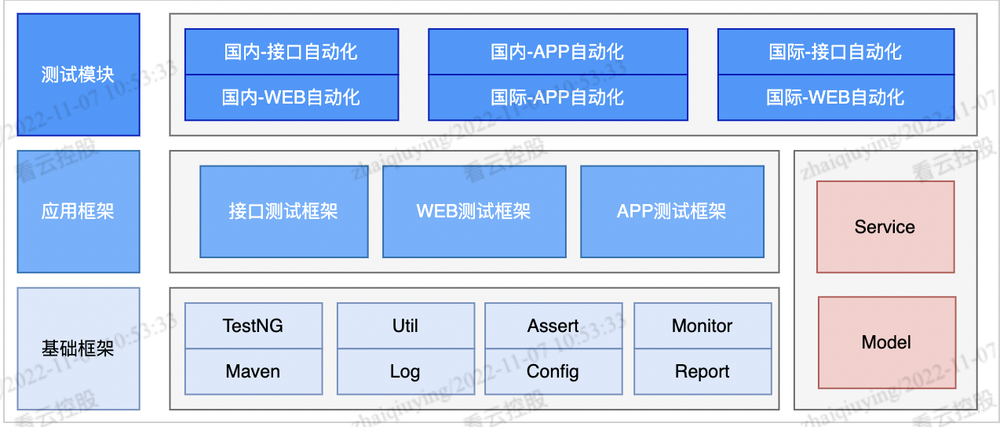
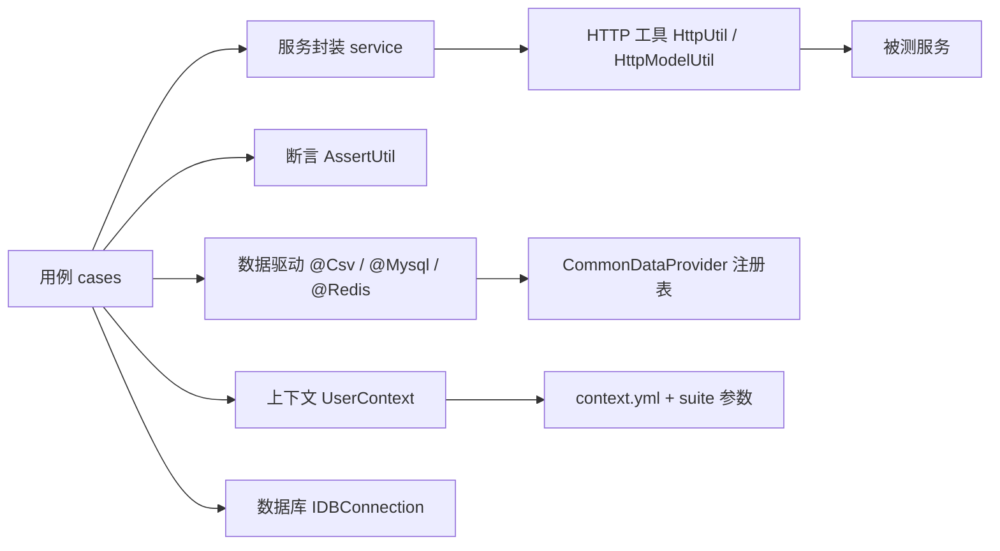

# auto-test-frame

基于 **TestNG + Spring** 的接口自动化测试框架，采用「引擎层 / 业务接入层」双模块设计，把用例编写成本压到最低：
打注解就能接数据源、重试、断言，账号与环境全部收敛到 suite 参数和 YAML，换环境不改代码。

- 语言/构建：Java 8 + Maven 多模块
- 依赖全部来自 Maven Central（无内网私有构件，克隆即可构建）
- 数据驱动：CSV / MySQL / Redis 三数据源，注解式接入
- 失败重试：`@Retry` 注解式重试，用例代码零改动（计数规则见「失败重试」）
- 上下文管理：用户 / 环境 / 设备 / App 四类配置按 `tag` 集中管理
- 断言体系：硬断言 + 软断言（方法内全部执行完再统一失败）

---

## 模块架构



| 模块 | 定位 | 主要包 | 说明 |
|---|---|---|---|
| **btest** | 测试引擎与基础设施 | `engine`、`db`、`model`、`util`、`logging`、`common` | 与业务无关，可被任意业务测试模块复用 |
| **itest** | 业务接入层 | `cases`、`service`、`model`、`engine.listener`、`util` | 提供 HTTP 用例基类、账号/环境上下文、service 封装 |



两部分的分工：

- **btest**：TestNG 引擎扩展（重试、监听器、DataProvider 注册表）、断言、DB 抽象层、HTTP 客户端、模型与工具类
- **itest**：继承 `btest` 能力，落地「HTTP 接口测试」场景 —— `BaseCase` 负责 Spring 启动与上下文装配，`CommonService` 提供请求 default 方法，`HttpModelUtil` 负责 URL 占位符替换与签名

---

## 环境要求

| 项 | 版本 |
|---|---|
| JDK | 1.8+ |
| Maven | 3.6+ |
| 数据库 | MySQL 5.7+（仅使用 `@Mysql` / `getConnection` 时需要） |

## 快速开始

```bash
# 1. 构建并安装到本地仓库（业务模块需要依赖 btest / itest）
mvn -DskipTests clean install

# 2. 编译检查
mvn -B clean test
```

框架本身不含业务用例，`mvn test` 只做编译校验。真正跑用例有两种方式：

**方式一：IDEA 运行 suite**（推荐）
在业务模块的 `testng.xml` 上右键 → Run，并加 VM 参数指定环境：

```
-DENV_TYPE=test
```

**方式二：Maven 运行**
在业务模块的 `pom.xml` 中加入 surefire 配置，然后 `mvn test`：

```xml
<plugin>
    <artifactId>maven-surefire-plugin</artifactId>
    <configuration>
        <suiteXmlFiles>
            <suiteXmlFile>src/test/resources/testng.xml</suiteXmlFile>
        </suiteXmlFiles>
        <systemPropertyVariables>
            <ENV_TYPE>test</ENV_TYPE>
        </systemPropertyVariables>
    </configuration>
</plugin>
```

---

## 目录结构

```
auto-test-frame
├── pom.xml                     # 父 POM，spring-boot-starter-parent 统一管理版本
├── btest/                      # 引擎层
│   └── src/main/java/com/example/qa/btest
│       ├── common/             # Config(Spring Bean)、Constant(环境/用例等级常量)
│       ├── db/                 # DataSourceFactory、IDataSource、IDBConnection、mysql/、redis/
│       ├── engine/
│       │   ├── asserts/        # AssertUtil、MethodBasedAssert(软断言)
│       │   ├── dataProvider/   # 注册表 CommonDataProvider + csv/、mysql/、redis/
│       │   ├── listener/       # @Retry、RetryAnalyzer、RetryListener、EachTestListener
│       │   └── monitor/        # 插件式通知(Receiver 加载 test-monitor/ 下的 jar)
│       ├── logging/            # LogConfig
│       ├── model/              # HttpModel、Executor、Runner、TestContext
│       └── util/               # HttpUtil、JsonUtil、CsvUtil、YamlUtil、StringUtil…
└── itest/                      # 业务接入层
    └── src/main/java/com/example/qa/itest
        ├── cases/BaseCase.java # 用例基类：Spring 启动 + 上下文装配
        ├── common/Config.java  # 加载 context.yml → CommonContext
        ├── engine/listener/    # ItestListener(EachTestListener + RetryListener)
        ├── model/              # User、UserContext、CommonContext
        ├── service/            # CommonService(HTTP default 方法) + Impl
        └── util/HttpModelUtil  # URL 占位符替换、签名
```

---

## 编写第一个用例

### 1. 继承 BaseCase

`BaseCase` 已完成三件事：启动 Spring 上下文、按 suite 参数装配 `userContext`、提供 `getUser` / `getConnection` 等便捷方法。

```java
package com.example.qa.itest.cases;

import com.example.qa.btest.engine.asserts.AssertUtil;
import com.example.qa.btest.engine.listener.Retry;
import com.example.qa.btest.model.Executor;
import com.example.qa.btest.util.HttpUtil;
import com.example.qa.itest.service.CommonService;
import org.springframework.beans.factory.annotation.Autowired;
import org.springframework.beans.factory.annotation.Qualifier;
import org.testng.annotations.Test;

public class HomePageCase extends BaseCase {

    @Autowired
    @Qualifier("commonService")
    private CommonService commonService;

    @Test(description = "首页可访问", groups = {"L0"})
    @Retry(maxNum = 1)
    public void testHomePage() {
        String result = commonService.sendAndGetHttpResult("/", HttpUtil.METHOD_GET, userContext);
        AssertUtil.assertTrue(
                new Executor<>(() -> result != null && !result.isEmpty()),
                "首页响应不应为空");
    }
}
```

> 方法名建议 `test*` 开头；`groups` 用 `Constant.L0/L1/L2/L3` 中的等级常量分组。

### 2. Service 层封装请求

用例不直接拼 URL，请求细节收敛到 service；`HttpModelUtil.create` 会自动做三件事：把相对路径拼上 `userContext.getEnv().getHost()`、替换 `{server}` / `{client}` / `{app_version}` 等占位符、URL 带 query 时追加签名参数；GET 参数拼到 query，POST 默认以 JSON 发送。

```java
public interface HomePageService {

    String getHomePage(UserContext userContext);
}

@Service("homePageService")
public class HomePageServiceImpl implements CommonService, HomePageService {

    @Override
    public String getHomePage(UserContext userContext) {
        // 相对路径 → host 来自 execute_env_host
        return sendAndGetHttpResult("/api/home/index", HttpUtil.METHOD_GET, userContext);
    }
}
```

`CommonService` 已提供的 default 方法：

| 方法 | 说明 |
|---|---|
| `sendAndGetHttpResult(url, method, user)` | 发请求并返回响应体字符串 |
| `sendAndGetHttpResult(url, method, user, param)` | 带参数版本（GET 拼 query，POST 发 JSON） |
| `sendHttpRequest(httpModel)` | 执行已知的 `HttpModel`，异常会包装为 `ServiceException` 并记日志 |

---

## 断言

### 硬断言（推荐用于关键校验）

`AssertUtil` 接收 `Executor`（`Runner` 的 lambda 包装），失败时把自定义 message 和原始异常一起抛出：

```java
AssertUtil.assertTrue(new Executor<>(() -> json.contains("\"code\":0")), "业务码应为 0");
AssertUtil.assertFalse(new Executor<>(() -> body.isEmpty()), "响应体不应为空");
```

### 软断言（一次跑完全部校验）

`*ByMethod` 系列不会立即中断方法，断言信息先收集到 `ThreadLocal`，方法结束后由 `EachTestListener` 统一判定失败 —— 因此**必须在 suite 中注册 `ItestListener`** 才生效：

```java
// 静态导入：import static com.example.qa.btest.engine.asserts.MethodBasedAssert.*;
assertEqualsByMethod(actualCode, "0");
assertTrueByMethod(body.contains("data"), "响应缺少 data 字段");
assertRegexEqualsByMethod(orderId, "\\d{16}");
```

> ⚠️ 不要在用例里 `try-catch` 吞掉断言异常，否则用例会「假通过」。

---

## 数据驱动（DDT）

`CommonDataProvider.genData` 会扫描测试方法上的注解，从注册表里找到对应的 `DataProvider` 实现取数据。
用例方法直接标注即可，无需写 `@DataProvider`：

```java
// CSV：相对路径会拼成 /{ENV_TYPE}/data/user_info.csv
@Test(dataProvider = "genData", dataProviderClass = CommonDataProvider.class)
@Csv("data/user_info.csv")
public void testLoginCsv(String phone, String expectCode) { ... }

// MySQL：不填 url/user/password 时取 suite 参数 mysql_url / mysql_user / mysql_password
@Test(dataProvider = "genData", dataProviderClass = CommonDataProvider.class)
@Mysql(sql = "select phone, expect_code from test_login where env = 'test'")
public void testLoginMysql(String phone, String expectCode) { ... }
```

`dataProvider = "genData"` + `dataProviderClass = CommonDataProvider.class` 是固定写法，由它按注解分发到具体数据源。

约定：

- CSV 首行为表头（读取时跳过），之后每行是一组入参，**按列顺序对应方法参数**，并自动按参数类型转换
- `@Csv(isRelativePath = false)` 可用 classpath 绝对路径
- 新增数据源无需改分发逻辑：实现 `DataProvider` 接口（`getDataType()` 返回注解 Class），再在 `CommonDataProvider` 静态块里 `register(...)` 即可

### Redis 数据源

`@Redis` 注解支持从 Redis 读取数据注入测试方法参数，使用方式与 `@Csv` / `@Mysql` 一致：

```java
@Test(dataProvider = "genData", dataProviderClass = CommonDataProvider.class)
@Redis(command = "GET", key = "user:1001:name", host = "127.0.0.1", port = 6379)
public void testUserName(String name) { ... }

// HGETALL 返回多行，每行两列（field, value），自动拆分为多组参数
@Test(dataProvider = "genData", dataProviderClass = CommonDataProvider.class)
@Redis(command = "HGETALL", key = "user:1001", host = "127.0.0.1", port = 6379)
public void testUserFields(String field, String value) { ... }

// 也可用 url 方式配置，或省略 host/port 使用 suite 参数 redis_host / redis_port
@Test(dataProvider = "genData", dataProviderClass = CommonDataProvider.class)
@Redis(command = "SET", key = "flag", value = "on", url = "redis://127.0.0.1:6379/0")
public void testSetFlag(String status) { ... }
```

`@Redis` 注解属性：

| 属性 | 默认值 | 说明 |
|---|---|---|
| `command` | `""` | Redis 命令（GET/SET/DEL/EXPIRE/HGET/HSET/HGETALL/HDEL/LRANGE/LPUSH/RPUSH） |
| `key` | `""` | 操作的 key |
| `field` | `""` | Hash field（HGET/HSET 等命令使用） |
| `value` | `""` | 值（SET/HSET 等命令使用） |
| `host` | `""` | Redis 主机地址，为空时取 suite 参数 `redis_host` |
| `port` | `6379` | Redis 端口 |
| `password` | `""` | 密码，为空时取 suite 参数 `redis_password` |
| `database` | `0` | 数据库编号 |
| `url` | `""` | 可选，`redis://host:port/db` 格式，设置后覆盖 host/port |

---

## 失败重试

```java
@Test
@Retry(maxNum = 2)   // 最多额外重试 2 次
public void testQuery() { ... }
```

`RetryListener` 是 `IAnnotationTransformer`，会为没有显式指定 `retryAnalyzer` 的方法自动挂上 `RetryAnalyzer`，因此用例上只写 `@Retry` 即可（前提是 suite 里注册了实现它的 `ItestListener`）。
重试次数上限以方法签名 MD5 为 key 缓存在静态 Map 中 —— 注意 **DDT 用例的多行数据会共用同一份计数**，这是当前实现的已知限制。

---

## 上下文与配置

### 四类上下文对象

| 对象 | 关键字段 | 说明 |
|---|---|---|
| `User` | `tag`、`ytkUserId`、`cookie`、`phone` | 登录态，`ytkUserId` + `cookie` 齐全才视为有效 |
| `User.Env` | `tag`、`host`、`type`、`laneId` | 被测环境，`host` 决定请求域名 |
| `User.Device` | `tag`、`client`、`id` | 设备/客户端信息 |
| `User.App` | `tag`、`name`、`version` | App 版本信息 |

用例里通过 `userContext.getEnv().getHost()` 等方式读取；`UserContext` 同时挂在 suite attribute 上供监听器使用。

### suite 参数（`execute_*` 前缀）

在 `testng.xml` 中注入，`BaseCase.beforeSuite` 负责装配：

```xml
<suite name="itest" parallel="methods" thread-count="5">
    <listeners>
        <listener class-name="com.example.qa.itest.engine.listener.ItestListener"/>
    </listeners>
    <parameter name="execute_env_tag"     value="test"/>
    <parameter name="execute_env_host"    value="https://example.com"/>
    <parameter name="execute_env_type"    value="test"/>
    <parameter name="execute_user_tag"    value="qa_user_01"/>
    <!-- 也可直接给值，直接给值时优先级高于 tag 查表 -->
    <parameter name="execute_user_phone"  value="13800000000"/>
</suite>
```

装配规则：**suite 参数给全了就直接用；只给了 tag，就从 `context.yml` 里按 tag 查表**。

| 参数 | 对应字段 |
|---|---|
| `execute_env_tag` / `execute_env_host` / `execute_env_type` / `execute_env_laneId` | `User.Env` |
| `execute_user_tag` / `execute_user_ytkUserId` / `execute_user_cookie` / `execute_user_phone` | `User` |
| `execute_device_tag` / `execute_device_client` / `execute_device_id` | `User.Device` |
| `execute_app_tag` / `execute_app_version` / `app_name` | `User.App` |
| `mysql_url` / `mysql_user` / `mysql_password` | `@Mysql` 默认连接 |
| `redis_host` / `redis_port` / `redis_password` | `@Redis` 默认连接 |

### 资源目录约定

所有资源按 **环境类型** 分目录，环境由系统属性 `ENV_TYPE` 决定（默认 `test`）：

```
src/test/resources
├── common/
│   └── ApplicationContext.xml          # Spring 扫描入口，必须存在
└── test/                               # = {ENV_TYPE}
    ├── config/common/logback.xml       # 日志配置，BaseCase 静态块按环境加载
    └── data/common/context.yml         # 账号/环境/设备/App/DB 清单
```

`context.yml` 结构：

```yaml
users:
  - tag: qa_user_01
    ytkUserId: "10001"
    cookie: "xxx"
envs:
  - tag: test
    host: https://example.com
    type: test
devices:
  - tag: iphone_13
    client: ios
apps:
  - tag: main_app
    version: 8.0.0
mysqls:
  - tag: order_db
    url: jdbc:mysql://127.0.0.1:3306/test
    user: root
    password: root
redises:
  - tag: cache_db
    host: 127.0.0.1
    port: 6379
    database: 0
```

> 说明：当前仓库尚未内置上述资源文件。`BaseCase` 强依赖 `classpath:common/ApplicationContext.xml`，
> `Config` 强依赖 `/{ENV_TYPE}/data/common/context.yml`，`BaseCase` 静态块强依赖
> `/{ENV_TYPE}/config/common/logback.xml` —— 在业务模块首次接入时按上面的结构补齐即可。

---

## 数据库访问

```java
@Test
public void testOrderStatus() throws SQLException {
    // context.yml 里 mysqls 定义的 tag
    IDBConnection conn = getConnection("order_db");
    try {
        List rows = (List) conn.execute("select id, status from orders where id = 1");
        assertEqualsByMethod(String.valueOf(rows.size()), "1");
    } finally {
        conn.close();
    }
}
```

`IDBConnection` 提供四个执行入口：`execute(sql)`（抛 `SQLException`）、`execute(sql, Execute)`（自定义结果集映射）、`executeWithoutException(sql)`（异常时返回空）、`executeWithClose(sql)`（执行完自动关连接）。

`DataSourceFactory` 按配置内容的 MD5 缓存数据源实例，同一份配置不会重复建连接池（Druid）。

### Redis 数据源访问（tag 接入）

在 `context.yml` 中配置 `redises` 段后，可通过 `getRedisConnection(tag)` 获取 Redis 连接：

```yaml
# context.yml
redises:
  - tag: cache_db
    host: 127.0.0.1
    port: 6379
    database: 0
  - tag: session_db
    url: redis://10.0.0.1:6380/1
```

```java
@Test
public void testCacheValue() throws SQLException {
    // context.yml 里 redises 定义的 tag
    IDBConnection conn = getRedisConnection("cache_db");
    try {
        // SET key value → 返回 [["OK"]]
        List setResult = (List) conn.execute("SET user:name test_user");
        // GET key → 返回 [["test_user"]]
        List getResult = (List) conn.execute("GET user:name");
    } finally {
        conn.close();
    }
}
```

`RedisConnection` 将 Redis 命令适配为 `IDBConnection.execute(String)` 接口，结果统一转换为 `List<List<Object>>` 格式，与 MySQL 数据源保持一致。

支持的命令及返回格式：

| 命令 | 返回结构 | 示例 |
|---|---|---|
| `GET key` | 单行单列 `[[value]]` | `GET user:name` → `[["test_user"]]` |
| `SET key value` | 单行单列 `[["OK"]]` | — |
| `DEL key1 key2` | 单行单列 `[[count]]` | `DEL k1 k2` → `[[2]]` |
| `EXPIRE key seconds` | 单行单列 `[[1]]` | — |
| `HGET hash field` | 单行单列 `[[value]]` | — |
| `HSET hash field value` | 单行单列 `[[count]]` | — |
| `HGETALL hash` | 多行两列 `[[f1,v1],[f2,v2]]` | — |
| `LPUSH key v1 v2` | 单行单列 `[[length]]` | — |
| `LRANGE key 0 -1` | 多行单列 `[[v1],[v2]]` | — |

---

## 技术栈

| 用途 | 组件 |
|---|---|
| 测试引擎 | TestNG 7.1.0 |
| 容器/装配 | Spring Framework（`spring-boot-starter` + `spring-test`） |
| HTTP | Apache HttpClient 4.5 |
| JSON | Gson、Jackson 2、JsonPath、org.json |
| 数据库 | Druid 1.2.8、MySQL Connector/J |
| Redis | Jedis 4.4.3、jedis-mock 1.1.21（测试） |
| 数据驱动 | test-data-provider（CSV 解析） |
| 配置 | SnakeYAML |
| 日志 | SLF4J + Logback |
| 工具 | Lombok、commons-lang3、commons-codec、Javassist |

---

## 常见问题

**Q：启动报 `FileNotFoundException` 或 `NullPointerException` 指向 logback / context.yml？**
`ENV_TYPE` 与资源目录不匹配。默认是 `test`，若资源放在 `dev/` 下，运行时需 `-DENV_TYPE=dev`。

**Q：用例里 `userContext` 为 null？**
`userContext` 只在 `BaseCase.beforeSuite` 中赋值，只有继承 `BaseCase` 的用例才能拿到；未继承基类时需自行从 suite attribute 取：`context.getSuite().getAttribute("userContext")`。

**Q：`@Csv` 提示找不到文件？**
相对路径会拼成 `/{ENV_TYPE}/data/...`，注意 `ENV_TYPE` 默认为空字符串（不是 `test`），建议运行时显式指定。

**Q：软断言没生效？**
检查 `testng.xml` 是否注册了 `com.example.qa.itest.engine.listener.ItestListener`（它实现了 `EachTestListener`，负责在方法结束后统一判定）。
